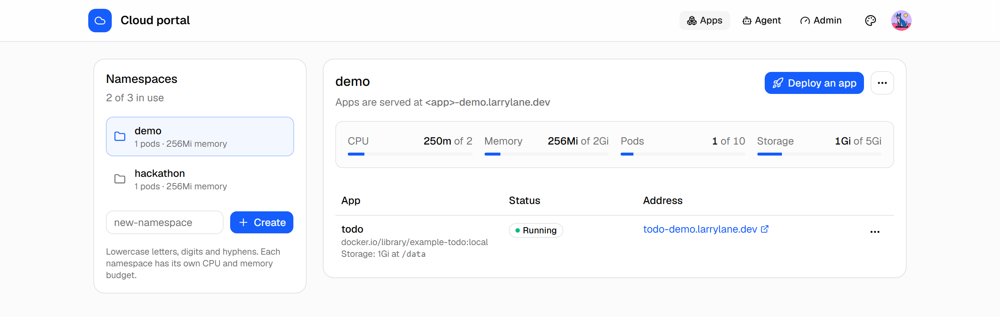
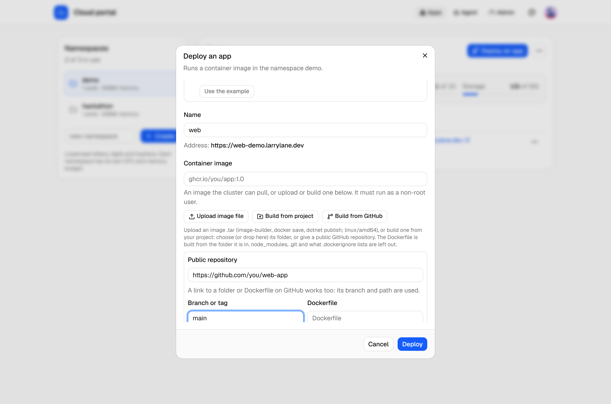
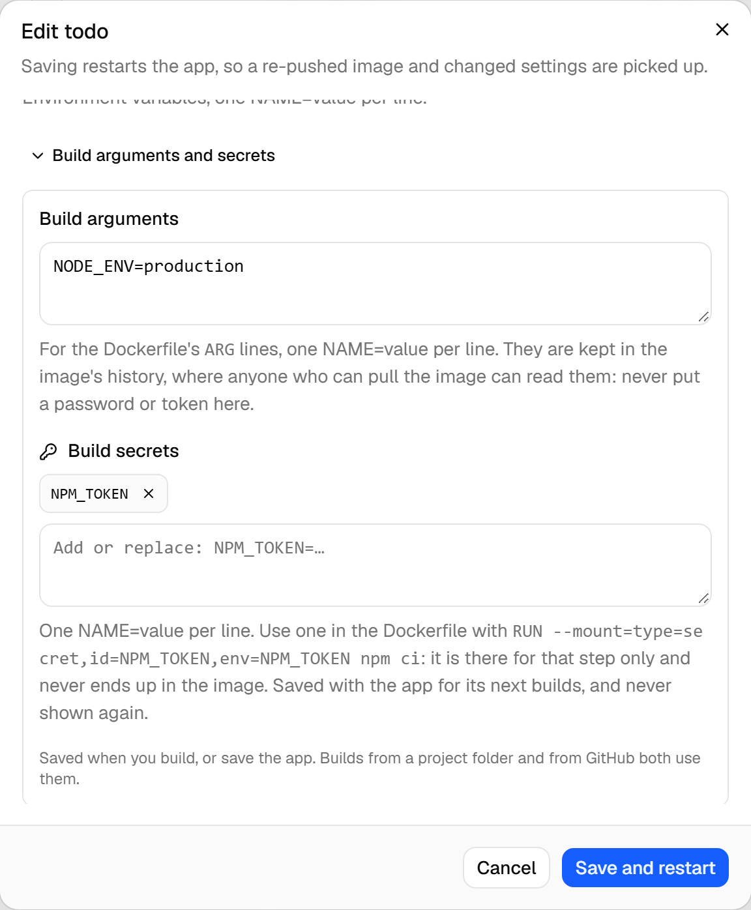
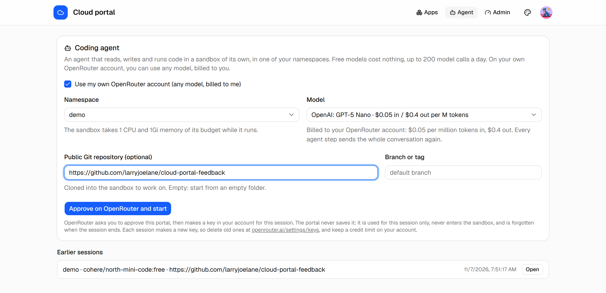
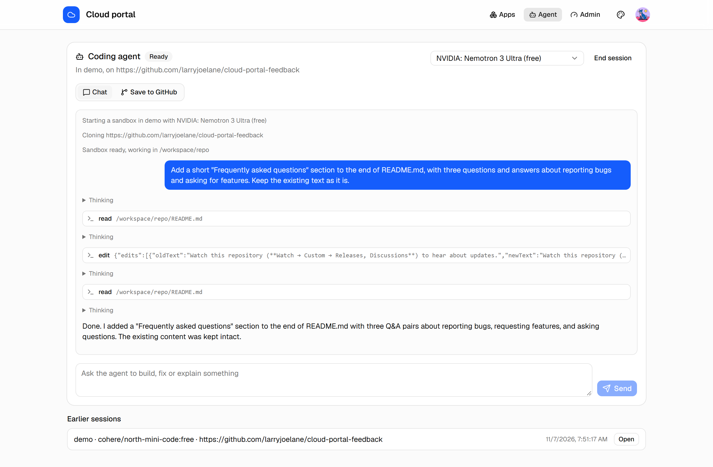
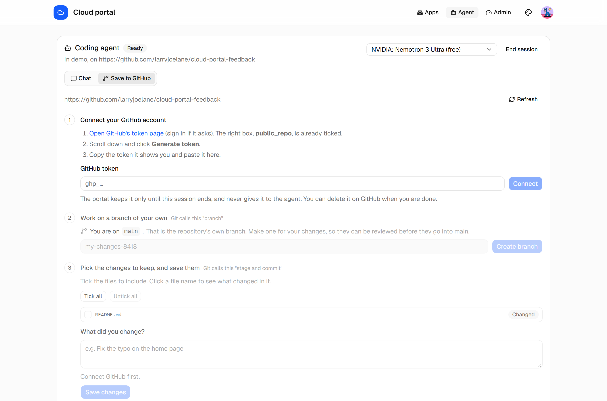

# Cloud Portal: updates and feedback

Cloud Portal is a self-service place to run apps and code with an AI agent:

- **Deploy apps** from a container image, a project folder or a GitHub repository, each in its own namespace, with HTTPS, storage and budgets.
- **Build images in the cluster** from a Dockerfile, with build arguments and build secrets.
- **Code with an agent** that reads, writes and runs code in a sandbox of its own, and saves its work to GitHub as a branch and pull request.

Access is by invitation for now.

## What it does

**Apps and namespaces.** Each namespace has its own CPU, memory, pod and storage budget. Every public app gets its own HTTPS address.

**Deploy from an image, a project folder or GitHub.** The image is built in the cluster from the repository's Dockerfile.

**Build arguments and secrets.** Secrets reach only the Dockerfile step that asks for them, never end up in the image, and are never shown again once saved.

**A coding agent in your namespace.** Free models are included, or use any model on your own OpenRouter account, billed to you. Your key is never saved.

The agent reads, edits and runs code in a sandbox of its own, and tells you what it changed.

**Save to GitHub, step by step.** Pick the changed files, make a branch, save, push and open a pull request, in plain words.

The source code is private. This repository is where the project talks in public: what changed, what's planned, and your bugs and ideas.

## Where to go

| I want to… | Go to |
|---|---|
| See what's new | [Changelog](CHANGELOG.md), and [Announcements](../../discussions/categories/announcements) |
| Report a bug | [New bug report](../../issues/new?template=bug_report.yml) |
| Ask for a feature | [New feature request](../../issues/new?template=feature_request.yml) |
| Ask a question or share an idea | [Discussions](../../discussions) |
| Report a security problem | Privately, as described in [SECURITY.md](SECURITY.md). Not in a public issue |

## How feedback is handled

Every issue is read and labelled. Ideas that go ahead are tracked here until they ship, and the changelog says when they do. Some work moves to the private repository, in which case the issue says so.

Watch this repository (**Watch → Custom → Releases, Discussions**) to hear about updates.
